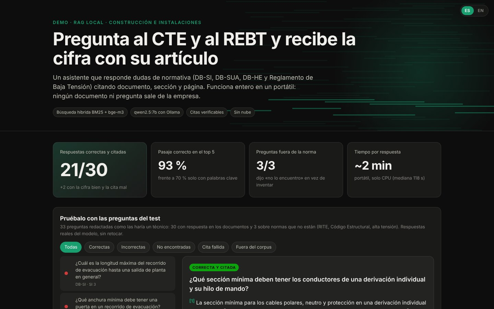

# rag-normativa-cte — local assistant for Spanish building regulations

**Live dashboard:** [alvaromcib.github.io/rag-normativa-cte](https://alvaromcib.github.io/rag-normativa-cte/) (Spanish) ·
[English](https://alvaromcib.github.io/rag-normativa-cte/en/)

Ask questions in Spanish about the **Código Técnico de la Edificación** (DB-SI fire safety, DB-SUA safety of use
and accessibility, DB-HE energy saving) and the **Reglamento Electrotécnico de Baja Tensión** (RD 842/2002 + ITC-BT),
and get a short answer with the document, section and page it comes from. Everything runs on a laptop:
no document or question leaves the machine.



## Results

Measured on a laptop CPU (Intel, no GPU) with `qwen2.5:7b` and `bge-m3` on Ollama. 30 hand-written questions that
the documents answer, plus 3 about regulations that are **not** indexed. Every answer was checked by hand against
the regulation text.

| Outcome (30 answerable questions) | n |
|---|---|
| Correct figure, cited passage contains it | **21** |
| Correct figure, citation points to the wrong passage | 2 |
| Wrong figure | 4 |
| Said "not found" although the answer is in the documents | 3 |
| **Out-of-scope questions: answered "No lo encuentro en los documentos indexados"** | **3 / 3** |

Median time per answer: ~2 min on CPU (most of it is the 7B model reading 6 passages).

Retrieval (passage that contains the gold figure, over 1,743 passages):

| Search | @1 | @5 | @10 | MRR |
|---|---|---|---|---|
| BM25 (keywords) | 60 % | 70 % | 83 % | 0.65 |
| bge-m3 embeddings | 67 % | **93 %** | 97 % | 0.77 |
| Hybrid (RRF) | **70 %** | 90 % | 93 % | 0.77 |

On this set hybrid fusion does not beat embeddings alone in the top 5. It is kept as the default because it ranks
first slightly more often and protects queries for literal codes and figures; that choice needs more questions to settle.

### What fails

- **Flattened tables** (3 of 9 misses): PDF extraction pulls some table columns apart, so the figure loses its row.
  Next step: extract tables as tables and index them row by row.
- **Neighbouring cases** (2 misses): the model takes the figure of an exception in the same paragraph
  (e.g. 50 m for floors with several exits instead of the general 25 m). Next step: a larger model, or a second pass
  that checks the stated figure against the cited passage.
- 1 retrieval miss, 1 abstention with the right passage in context, 2 wrong citations.
- The model sometimes appends "No lo encuentro…" after a valid answer (7 times); `rag.clean()` trims that tail.

Every answer is shown next to the passage it cites, so a technician can verify it in seconds. The assistant helps
to search the regulation; it does not replace reading it.

## Pipeline

1. **Ingest** (`src/ingest.py`): official PDFs → 1,743 passages that keep their structure
   (document · section/ITC/article/annex · sub-section · page). Running headers, page numbers and
   table-of-contents lines are removed.
2. **Retrieve** (`src/retrieve.py`): BM25 for literal figures and codes (`ITC-BT-25`, `0,90 m`) plus multilingual
   embeddings (`bge-m3` via Ollama), fused with Reciprocal Rank Fusion.
3. **Answer** (`src/rag.py`): `qwen2.5:7b` answers only from the 6 retrieved passages, cites them by number and says
   *"No lo encuentro en los documentos indexados"* when they don't contain the answer.
4. **Evaluate** (`eval/`, `src/eval_retrieval.py`, `src/eval_answers.py`, `src/score_answers.py`).

## Run

```bash
pip install -r requirements.txt
ollama pull bge-m3 && ollama pull qwen2.5:7b
python src/retrieve.py --build          # embedding index (already committed in data/index/)
python src/rag.py "¿Qué altura mínima deben tener las barandillas?"
python src/eval_retrieval.py            # bm25 / dense / hybrid
python src/eval_answers.py              # full RAG on the 33 questions (~1 h on a laptop CPU)
python src/score_answers.py && python src/build_dashboard.py
```

On Windows, `scripts/run_local_windows.bat` runs the index and both evaluations. The PDFs are not in the repo:
`python src/get_docs.py` downloads them from codigotecnico.org and boe.es (only needed to re-run the ingestion).

## Sources

CTE DB-SI, DB-SUA and DB-HE ([codigotecnico.org](https://www.codigotecnico.org)) and RD 842/2002, consolidated text
([BOE](https://www.boe.es/buscar/act.php?id=BOE-A-2002-18099), last update 03/09/2025).
Demo with public documents and no client data; it does not replace reading the regulation or a professional's judgement.

---
Álvaro Martín Coll · [Malt](https://www.malt.com/profile/alvaromartincoll) · [GitHub](https://github.com/alvaromcib)
